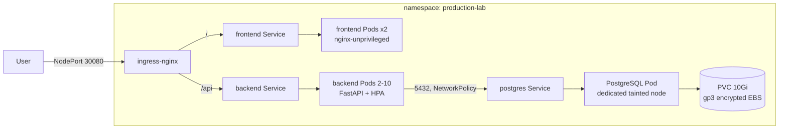

# kubernetes-lab

[](https://github.com/Prajjawalsingh87/kubernetes-lab/actions/workflows/ci.yml)

A production-style, three-tier application (static frontend, FastAPI backend,
PostgreSQL) deployed on a **self-managed `kubeadm` cluster on AWS EC2**. It is
a hands-on lab for the parts of Kubernetes that matter in production:
probes, resource limits, rolling updates, HPA, PDBs, NetworkPolicy,
taints/tolerations/affinity, persistent EBS storage, Pod Security Standards
and failure-injection exercises.

> The full cluster runbook lives in
> [`kubernetes-production-lab/README.md`](kubernetes-production-lab/README.md).
> This page is the overview.

## Architecture



| Component | Image | Notes |
|---|---|---|
| Frontend | `nginxinc/nginx-unprivileged:1.27.5-alpine` | Static `index.html`, `/health` endpoint, UID 101 |
| Backend | `python:3.11.13-slim-bookworm` | FastAPI + asyncpg, `/api/health/live`, `/api/health/ready`, `/api/database`, Prometheus `/metrics` (cluster-internal), UID 1000 |
| Database | `postgres:16.15-alpine3.24` | `Recreate` strategy, retained encrypted EBS volume, UID 70 |

More detail: [docs/architecture.md](kubernetes-production-lab/docs/architecture.md).

## Quick start (local, no Kubernetes)

Requires Docker with the Compose plugin.

```bash
git clone https://github.com/Prajjawalsingh87/kubernetes-lab.git
cd kubernetes-lab/kubernetes-production-lab
docker compose up --build
```

- Frontend: <http://localhost:8081> (click **Check Backend and Database**)
- Backend: <http://localhost:8080/api/health/ready>, <http://localhost:8080/api/database>
- Metrics: <http://localhost:8080/metrics> (Prometheus text format)

Stop and delete the local volume with `docker compose down -v`.

## Deploy to the cluster (summary)

1. Build a kubeadm cluster: 1 control plane + 3 workers, Calico, all nodes `Ready`.
2. Label/taint nodes (`workload=application` x2, `workload=postgres` + `dedicated=postgres:NoSchedule` x1).
3. Install ingress-nginx (NodePort 30080), Metrics Server and the AWS EBS CSI driver.
4. Build and push both images to ECR, then point the overlay's `images:` at them.
5. Create the database Secret input and apply:

   ```bash
   cd kubernetes-production-lab
   cp manifests/overlays/self-managed/secrets.env.example manifests/overlays/self-managed/secrets.env
   $EDITOR manifests/overlays/self-managed/secrets.env   # set a strong DB_PASSWORD
   kubectl apply -k manifests/overlays/self-managed
   ```

6. Verify with `kubectl -n production-lab get deploy,pods,svc,ingress,hpa,pvc` and
   `curl http://<worker-public-ip>:30080/api/health/ready`.

Exact commands for each step are in the
[lab runbook](kubernetes-production-lab/README.md).

## Project structure

```text
kubernetes-lab/
├── .github/workflows/ci.yml          # lint, manifest validation, docker builds, compose smoke test
└── kubernetes-production-lab/
    ├── backend/                      # FastAPI service, /metrics, tests/ + Dockerfile
    ├── frontend/                     # static page, nginx.conf + Dockerfile
    ├── local/nginx.conf              # compose-only nginx config (proxies /api)
    ├── docker-compose.yml            # local stack (+ `observability` profile: Prometheus, Grafana)
    ├── dashboards/backend.json       # Grafana dashboard (provisioned locally, importable in-cluster)
    ├── observability/
    │   ├── prometheus/               # prometheus.yml, alerts.yml + promtool unit tests
    │   └── grafana/provisioning/     # datasource + dashboard provider
    ├── tests/load/smoke.js           # k6 load test (20 VUs, p95 < 500ms, errors < 1%)
    ├── manifests/
    │   ├── base/                     # Namespace, Deployments, Services, Ingress, HPA, PDB, NetworkPolicy, storage
    │   ├── overlays/self-managed/    # namespace, images, Secret generator, ingress patch
    │   └── monitoring/               # optional PodMonitor + PrometheusRule (needs Prometheus Operator CRDs)
    ├── scripts/check_autoscaling.py  # CI cross-check of HPA / Deployment / PDB
    ├── scripts/check_prometheusrule.py # CI: PrometheusRule == alerts.yml
    ├── infrastructure/               # Cluster Autoscaler Helm values + IAM policy
    ├── docs/
    │   ├── architecture.md
    │   └── troubleshooting/          # ingress, pod-scheduling, service, storage exercises
    └── evidence/README.md            # what to capture for the lab write-up
```

## CI

Every pull request and every push to `main` runs [`.github/workflows/ci.yml`](.github/workflows/ci.yml):

- `ruff`, `py_compile` and `pytest` (metrics unit tests) on the backend
- `kubectl kustomize` of base and overlay, validated with `kubeconform --strict`
  (including the HPA and PDBs), plus
  [`scripts/check_autoscaling.py`](kubernetes-production-lab/scripts/check_autoscaling.py),
  which checks that the HPA targets a Deployment with a CPU request and no
  `replicas:`, and that a PDB covers its Pods without blocking all evictions
- `promtool check rules`, `promtool test rules` (alert unit tests) and
  `promtool check config` using the `prom/prometheus` image; a check that the
  `PrometheusRule` manifest matches `alerts.yml`; dashboard JSON validity; and
  `kubeconform` of `manifests/monitoring` against the CRD schema catalog
- `docker build` of backend and frontend
- `docker compose --profile observability` end-to-end smoke test (frontend → backend → PostgreSQL), including
  `/metrics` (`database_up 1`, per-route counters), a check that `/metrics`
  is not reachable through the frontend, Prometheus scraping the backend with the
  three alert rules loaded, and Grafana serving the provisioned dashboard
- a k6 load test ([`tests/load/smoke.js`](kubernetes-production-lab/tests/load/smoke.js),
  `grafana/k6` image) against that stack: ramp to 20 VUs, 30 s hold, fails if
  p95 ≥ 500 ms or more than 1 % of requests fail

No cloud credentials are needed. Pushing images and deploying to the cluster stay manual.

## Observability and autoscaling

**Prometheus metrics.** The backend serves `GET /metrics` (via `prometheus_client`):

| Metric | Type | Labels | Meaning |
|---|---|---|---|
| `http_requests_total` | counter | `method`, `route`, `status` | Requests handled |
| `http_request_duration_seconds` | histogram | `method`, `route` | Request latency (5 ms – 10 s buckets) |
| `database_up` | gauge | – | `1` if `SELECT 1` against PostgreSQL succeeded on the last scrape/readiness check, else `0` |

`route` is the FastAPI route *template* (e.g. `/api/database`), never the raw
URL, and every unknown path is reported as `route="unmatched"`, so label
cardinality stays bounded. Standard `python_*`/`process_*` metrics are included too.
`/metrics` is not under `/api`, so neither the Ingress nor the local nginx exposes
it publicly; the backend Pod template carries `prometheus.io/scrape|port|path`
annotations for annotation-based in-cluster scraping. Example queries:

```promql
sum by (route) (rate(http_requests_total[5m]))
histogram_quantile(0.95, sum by (le, route) (rate(http_request_duration_seconds_bucket[5m])))
min(database_up)
```

**Dashboard, alerts and load test (local).** The `observability` Compose profile adds
Prometheus (scraping `backend:8080/metrics` every 5 s, alert rules loaded) and
Grafana with the dashboard preloaded:

```bash
cd kubernetes-production-lab
docker compose --profile observability up -d --build
# Grafana    http://localhost:3000  (anonymous viewer; admin / $GRAFANA_ADMIN_PASSWORD, default admin)
# Prometheus http://localhost:9090  (Status → Targets, Alerts)
docker run --rm -i --network host -e BASE_URL=http://localhost:8081 \
  grafana/k6:1.3.0 run - < tests/load/smoke.js      # watch the dashboard move
docker compose --profile observability down -v
```

[`dashboards/backend.json`](kubernetes-production-lab/dashboards/backend.json)
(“Production lab / Backend”) shows requests/s by route and by status, p50/p95/p99
latency from the histogram (overall and p95 per route), the 5xx error ratio,
`database_up`, scraped backend targets and – when kube-state-metrics is present –
HPA current/desired/max replicas. It has a data-source and `job` selector, so it
can be imported into any Grafana in front of the cluster's Prometheus.

Alert rules ([`observability/prometheus/alerts.yml`](kubernetes-production-lab/observability/prometheus/alerts.yml),
unit-tested in `alerts_test.yml`):

| Alert | Condition | For | Severity |
|---|---|---|---|
| `BackendDown` | `up{job="backend"} == 0` or `database_up == 0` | 2m | critical |
| `HighErrorRate` | 5xx / all requests > 5 % (5m rate) | 5m | warning |
| `HighLatency` | p95 of `http_request_duration_seconds` > 500 ms | 10m | warning |

In-cluster with the Prometheus Operator (e.g. kube-prometheus-stack), apply the
optional add-on: `kubectl apply -k kubernetes-production-lab/manifests/monitoring`
(a `PodMonitor` that sets `job="backend"` and a `PrometheusRule` with the same
groups). It is deliberately **not** in the base Kustomization or the overlay, so
the default deploy does not need the `monitoring.coreos.com` CRDs. Adjust the
`release:` label if your Prometheus selects rules/monitors differently.

**HorizontalPodAutoscaler** ([`manifests/base/autoscaling.yaml`](kubernetes-production-lab/manifests/base/autoscaling.yaml)):
`autoscaling/v2`, backend 2–10 replicas on **CPU** utilization 60 % of the
500m request, fast scale-up and a 5-minute scale-down stabilization. The backend
Deployment deliberately has **no `replicas:`** so `kubectl apply` never resets
the HPA's decision. Needs Metrics Server (`kubectl -n production-lab get hpa backend`).

> Upgrading an existing cluster: because `replicas` was removed from the
> Deployment, the first `kubectl apply` after this change drops the backend to
> 1 replica until the HPA (min 2) scales it back up within ~15 s. To avoid even
> that blip, run `kubectl -n production-lab apply edit-last-applied deployment/backend`
> and delete the `replicas` line before applying.

**PodDisruptionBudgets** ([`manifests/base/availability.yaml`](kubernetes-production-lab/manifests/base/availability.yaml)):
`minAvailable: 1` for backend and frontend, so node drains and Cluster Autoscaler
scale-downs evict at most one Pod at a time while still being able to proceed
(HPA `minReplicas: 2` > `minAvailable`).

All three are part of the base Kustomization and therefore of the
`self-managed` overlay.

## Troubleshooting

| Symptom | Likely cause / fix |
|---|---|
| Backend exits with `Missing required variables` | `application-config` ConfigMap or `database-credentials` Secret missing. Check `secrets.env` exists before `kubectl apply -k`. |
| Backend Pods not `Ready` (503 on `/api/health/ready`) | PostgreSQL not reachable: check the postgres Pod, Service endpoints and the NetworkPolicy labels. |
| PostgreSQL Pod `Pending` | No node labelled `workload=postgres`, or the PVC can't bind (EBS CSI driver / IAM missing). See [pod-scheduling](kubernetes-production-lab/docs/troubleshooting/pod-scheduling.md) and [storage](kubernetes-production-lab/docs/troubleshooting/storage.md). |
| `ImagePullBackOff` | Wrong ECR name/tag in the overlay, or the node role lacks `AmazonEC2ContainerRegistryReadOnly`. |
| Pods rejected by Pod Security | The namespace enforces `restricted`. Keep `runAsNonRoot`, seccomp `RuntimeDefault`, `drop: [ALL]`. |
| HPA shows `<unknown>` targets | Metrics Server not installed or needs `--kubelet-insecure-tls` on kubeadm. |
| 404 from NodePort 30080 | Ingress class mismatch. See [ingress](kubernetes-production-lab/docs/troubleshooting/ingress.md). |
| Service has no endpoints | Selector/label mismatch. See [service](kubernetes-production-lab/docs/troubleshooting/service.md). |

## Security notes

- `secrets.env` is git-ignored. Only `secrets.env.example` (placeholder values) is committed.
- All containers run as non-root, with read-only root FS on the backend and all capabilities dropped.
- Only the ingress NodePort is public; backend and PostgreSQL are `ClusterIP` only.


## October 2026 improvements

The frontend now shows a responsive service dashboard with request duration, check time, a ten-second timeout and clear failure feedback. Duplicate checks are disabled while a request is in progress. The dashboard displays actual API/database responses.


The UI depends on the lab's `/api/database` ingress route. Run it with the existing
Docker Compose or Kubernetes setup; a standalone Vercel deployment would not
include the cluster, database or ingress. No live cluster changes are required
for this UI update.
