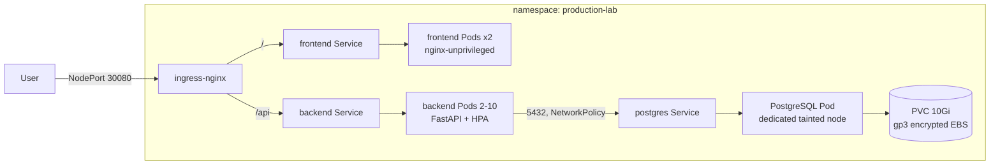

# kubernetes-lab

[](https://github.com/Prajjawalsingh87/kubernetes-lab/actions/workflows/ci.yml)

A production-style, three-tier application (static frontend, FastAPI backend,
PostgreSQL) deployed on a **self-managed `kubeadm` cluster on AWS EC2**. It is
a hands-on lab for the parts of Kubernetes that matter in production:
probes, resource limits, rolling updates, HPA, PDBs, NetworkPolicy,
taints/tolerations/affinity, persistent EBS storage, Pod Security Standards
and failure-injection exercises.

> The full cluster runbook lives in
> [`kubernetes-production-lab/README.md`](kubernetes-production-lab/README.md).
> This page is the overview.

## Architecture



| Component | Image | Notes |
|---|---|---|
| Frontend | `nginxinc/nginx-unprivileged:1.27.5-alpine` | Static `index.html`, `/health` endpoint, UID 101 |
| Backend | `python:3.11.13-slim-bookworm` | FastAPI + asyncpg, `/api/health/live`, `/api/health/ready`, `/api/database`, UID 1000 |
| Database | `postgres:16.15-alpine3.24` | `Recreate` strategy, retained encrypted EBS volume, UID 70 |

More detail: [docs/architecture.md](kubernetes-production-lab/docs/architecture.md).

## Quick start (local, no Kubernetes)

Requires Docker with the Compose plugin.

```bash
git clone https://github.com/Prajjawalsingh87/kubernetes-lab.git
cd kubernetes-lab/kubernetes-production-lab
docker compose up --build
```

- Frontend: <http://localhost:8081> (click **Check Backend and Database**)
- Backend: <http://localhost:8080/api/health/ready>, <http://localhost:8080/api/database>

Stop and delete the local volume with `docker compose down -v`.

## Deploy to the cluster (summary)

1. Build a kubeadm cluster: 1 control plane + 3 workers, Calico, all nodes `Ready`.
2. Label/taint nodes (`workload=application` x2, `workload=postgres` + `dedicated=postgres:NoSchedule` x1).
3. Install ingress-nginx (NodePort 30080), Metrics Server and the AWS EBS CSI driver.
4. Build and push both images to ECR, then point the overlay's `images:` at them.
5. Create the database Secret input and apply:

   ```bash
   cd kubernetes-production-lab
   cp manifests/overlays/self-managed/secrets.env.example manifests/overlays/self-managed/secrets.env
   $EDITOR manifests/overlays/self-managed/secrets.env   # set a strong DB_PASSWORD
   kubectl apply -k manifests/overlays/self-managed
   ```

6. Verify with `kubectl -n production-lab get deploy,pods,svc,ingress,hpa,pvc` and
   `curl http://<worker-public-ip>:30080/api/health/ready`.

Exact commands for each step are in the
[lab runbook](kubernetes-production-lab/README.md).

## Project structure

```text
kubernetes-lab/
├── .github/workflows/ci.yml          # lint, manifest validation, docker builds, compose smoke test
└── kubernetes-production-lab/
    ├── backend/                      # FastAPI service + Dockerfile
    ├── frontend/                     # static page, nginx.conf + Dockerfile
    ├── local/nginx.conf              # compose-only nginx config (proxies /api)
    ├── docker-compose.yml            # local stack
    ├── manifests/
    │   ├── base/                     # Namespace, Deployments, Services, Ingress, HPA, PDB, NetworkPolicy, storage
    │   └── overlays/self-managed/    # namespace, images, Secret generator, ingress patch
    ├── infrastructure/               # Cluster Autoscaler Helm values + IAM policy
    ├── docs/
    │   ├── architecture.md
    │   └── troubleshooting/          # ingress, pod-scheduling, service, storage exercises
    └── evidence/README.md            # what to capture for the lab write-up
```

## CI

Every pull request and every push to `main` runs [`.github/workflows/ci.yml`](.github/workflows/ci.yml):

- `ruff` and `py_compile` on the backend
- `kubectl kustomize` of base and overlay, validated with `kubeconform --strict`
- `docker build` of backend and frontend
- `docker compose` end-to-end smoke test (frontend → backend → PostgreSQL)

No cloud credentials are needed. Pushing images and deploying to the cluster stay manual.

## Troubleshooting

| Symptom | Likely cause / fix |
|---|---|
| Backend exits with `Missing required variables` | `application-config` ConfigMap or `database-credentials` Secret missing. Check `secrets.env` exists before `kubectl apply -k`. |
| Backend Pods not `Ready` (503 on `/api/health/ready`) | PostgreSQL not reachable: check the postgres Pod, Service endpoints and the NetworkPolicy labels. |
| PostgreSQL Pod `Pending` | No node labelled `workload=postgres`, or the PVC can't bind (EBS CSI driver / IAM missing). See [pod-scheduling](kubernetes-production-lab/docs/troubleshooting/pod-scheduling.md) and [storage](kubernetes-production-lab/docs/troubleshooting/storage.md). |
| `ImagePullBackOff` | Wrong ECR name/tag in the overlay, or the node role lacks `AmazonEC2ContainerRegistryReadOnly`. |
| Pods rejected by Pod Security | The namespace enforces `restricted`. Keep `runAsNonRoot`, seccomp `RuntimeDefault`, `drop: [ALL]`. |
| HPA shows `<unknown>` targets | Metrics Server not installed or needs `--kubelet-insecure-tls` on kubeadm. |
| 404 from NodePort 30080 | Ingress class mismatch. See [ingress](kubernetes-production-lab/docs/troubleshooting/ingress.md). |
| Service has no endpoints | Selector/label mismatch. See [service](kubernetes-production-lab/docs/troubleshooting/service.md). |

## Security notes

- `secrets.env` is git-ignored. Only `secrets.env.example` (placeholder values) is committed.
- All containers run as non-root, with read-only root FS on the backend and all capabilities dropped.
- Only the ingress NodePort is public; backend and PostgreSQL are `ClusterIP` only.
